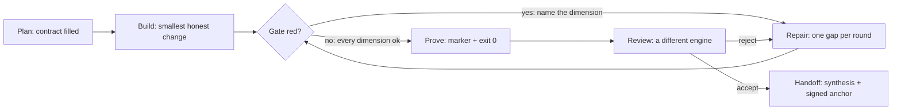

<div align="center">

# loopagent

### Accept agent work by proof, not by confidence.

A stdlib-only gate that refuses to take an agent's word: it runs the commands, prints one marker,
and exits non-zero until the evidence matches the claim. It ships as a pip package (`loopgate`) with the
gates inside, plus a skill (`loop-engineering`) that tells an agent how to work inside the loop.

[](LICENSE)
[](#install)
[](#install)
[](#the-fourteen-dimensions)
[](#sixty-seconds)

</div>

```
$ python3 -m loopgate.gates.check_loop --strict   # abridged: fourteen dimensions, six shown here
D01 contract_skill             [OK] .agents/skills/loop-engineering/SKILL.md contract complete
D02 sources_of_truth           [OK] AGENTS.md + PLANS.md + README.md carry the contract and the gate command
D03 loop_state                 [OK] artifacts/loop_state.json schema + monotone history ok
D04 rounds                     [OK] 6 round artifact(s) with bound evidence
D05 handoff                    [OK] handoff bound to the gate's machine report
D06 guardrail_no_direct_cli    [OK] no direct CLI-agent invocation in repo code or pasteable commands
...
dims: 13 ok, 0 fail, 1 n/a (D08) (mandatory: 12, optional: 2)
acceptance: strict-complete
LOOP_ENGINEERING_PASS_0001
```

> **Two names, one project.** The repository is `loopagent`; the CLI and the Python package are
> `loopgate` — the name it grew under. Stated once so nobody hunts for a missing package.

---

## Why it exists

An agent produces a plausible pull request faster than a human can read it. *"Tests pass"* is the
sentence that ends review, and it is not evidence: the tests may not have run, may have run against
the old tree, may have been skipped, or may cover nothing that changed. The second failure is
subtler — everything is green and the product does not start.

This repository turns that discipline into commands. Not a checklist, not a prompt: a gate with
fourteen dimensions, a marker, and an exit code.

## Three verdicts, three questions

| Verdict | Question it answers | Command |
|---|---|---|
| **Technical gate** | was the work actually done, on every gate this repository requires? | `python3 -m loopgate.gates.check_loop --strict` |
| **Product gate** | can a user do their job with it? | `python3 -m loopgate.gates.check_product` |
| **Change health** | did this change make the tree worse, even though every gate stayed green? | `python3 -m loopgate.gates.change_health` |

Each verdict prints exactly one marker and one exit code. A marker is printed **only** by the gate that
earned it — an agent that prints `LOOP_ENGINEERING_PASS_0001` itself is a bug, and one of the dimensions
exists to catch that class of cheating.

## The cycle



`Build → Fail → Repair → Prove → Review → Handoff`. Every round leaves a file with the command, the
verbatim output and the exit code; knowledge that stays only in a model's context dies with the
context. The gate is read-only — it may write only when handed an explicit `--report` path — so a
check can never repair the thing it is checking.

## The fourteen dimensions

| ID | Dimension | What must be true |
|---|---|---|
| `D01` | contract_skill | the run contract exists: goal, sources of truth, constraints, done-when, stop-if |
| `D02` | sources_of_truth | `AGENTS.md`, `PLANS.md` and this README carry the contract and the gate command |
| `D03` | loop_state | `artifacts/loop_state.json`: schema, `0..100` ranges, phase, marker |
| `D04` | rounds | ≥3 round artifacts with `Gap / Change / Evidence / Metrics / Next` |
| `D05` | handoff | handoff bound to the gate's machine report; hash recomputed without `D05` itself |
| `D06` | guardrail_no_direct_cli | no direct CLI-agent invocation in code or pasteable commands |
| `D07` | guardrail_no_secrets | no credential-shaped strings anywhere in the tree |
| `D08` | course_corpus | the study corpus is assembled (N/A — not shipped in this tree) |
| `D09` | roles_fanout | four role artifacts, each ≥300 chars, each attributed to a run |
| `D10` | issue_bridge | the brief *inside* the task carries every gate, and the validator is attacked |
| `D11` | product_gate | user scenarios, each with a `why`; the evaluator is mutated, not trusted |
| `D12` | anchor_witness | the verdict is signed, and the anchor cannot certify itself |
| `D13` | visual_gate | headless browser present, screenshots required, 23 fake pages rejected |
| `D14` | change_health | countable metrics compared to a baseline, in the direction that means "worse" |

A dimension is worth having only if it can fail: every one of them comes with an injection in
`loopgate/gates/regressions.py` that reddens the gate on *that* dimension. A dimension with no falsification
case is a slogan.

## Install

```bash
git clone https://github.com/mjeksonpx/loopagent.git && cd loopagent
python3 -m loopgate.gates.doctor                   # what this interpreter can run, before yellow is a mystery
make check                                  # what CI runs: compile + code dimensions + regressions
```

Nothing to install: no third-party dependency in the core, no daemon, no database, no schema to
migrate. Optional extras (`jsonschema` for one product scenario) degrade to a `SKIP` **with a stated
reason**, never to a silent PASS.

One machine prerequisite is not optional: the visual dimension (`D13`) needs **Chrome or Chromium**, and
`make check` fails without it (`CI_DIMS_STOP_0001`). That is deliberate — a visual check that silently
skips is worse than none — and `python3 -m loopgate.gates.doctor` names what this interpreter found before
a red dimension looks like a mystery. `make check` also needs `make` and Python 3.9+.

```bash
python3 -m loopgate.gates.bootstrap_state --init   # first run: declare the cold start
# -> LOOP_STATE_COLD_0001   wrote artifacts/loop_state.json: state=cold, round=0

python3 -m loopgate.gates.check_loop --strict
# -> 8 ok, 0 fail, 5 cold, 1 n/a
#    cold start: 5 state dimension(s) cannot be proven in this tree (D03, D04, D05, D09, D12)
#    LOOP_ENGINEERING_COLD_0001        exit 0
```

A fresh clone answers `COLD`, not `PASS`. That is the design: round artifacts, the handoff and the
signed anchor are evidence of *a run*, not source, so they live in gitignored state. As soon as one
round exists, the declaration is refused — a cold start cannot hide a broken loop behind an empty
directory.

```bash
pip install -e ".[contracts]"               # optional: the `loopgate` command
loopgate gate --strict                      # identical to the module; the command only names it
loopgate status                             # both verdicts + the queue on one operator page
loopgate --repo ../other gate --strict      # judge another project instead of the working directory
```

## Use it in another project

The gates ship inside the package, so a project does not need a copy of this repository:

```bash
pip install "git+https://github.com/mjeksonpx/loopagent.git"
cd your-project                              # a git repository, or one with AGENTS.md
loopgate init                                # writes the contract skill, AGENTS.md / PLANS.md / README.md,
                                             # and declares the cold start (never a fabricated PASS)
loopgate gate --strict                       # -> STOP: names what the project still has to configure
```

`init` never overwrites an existing `AGENTS.md`, `PLANS.md` or `README.md`, and it writes no round, handoff
or anchor: those are evidence of a run. The first verdict is STOP, not COLD, because D10–D14 are facts about
the project itself (its evidence bundle, product scenarios, signing key, visual scenarios, metric baseline).
`init` lists each one; the gate never passes them on a template.

### The skill

`loopgate init` writes `.agents/skills/loop-engineering/SKILL.md`. It is the procedure an agent follows: when
to start a loop, how to fill the run contract, how to repair one dimension per round, and when to stop.
Read it before a task that needs more than one pass.

Hermes loads project skills only from a trusted repository. The first run in a repo with project skills shows
a notice; trust the repo once:

```bash
hermes skills trust                # from inside the project
```

Then start the session inside the project and ask for the task with the trigger words from the skill
(`loop engineering`, `bounded loop`, `iterate until green`). The skill reads the gate; it does not replace it.

Use the skill when the work needs rounds with evidence: a release gate, a refactor that must stay green,
a multi-step fix. Skip it for a one-off edit that one command verifies.

Python **3.9+** on paper, **3.12** in CI: one interpreter, so a green badge means "this runs", not
"this may run somewhere". `loopgate <cmd>` forwards every argument to the script of the same name —
the wrapper is a convenience, never a requirement.

`--repo PATH` goes before the command name and runs the script that lives in that checkout, so the
gate judges that tree instead of this one. It is deliberately not recognised after the command:
`worker_brief.py` has its own `--repo` (the repository slug for the issue URL), and the wrapper must
not steal it.

## Sixty seconds

```bash
python3 -m loopgate.gates.check_loop
#  -> prints every dimension. State that belongs to a run is red here, because this tree has never
#     run: the strict marker is not something you can clone.

python3 -m loopgate.gates.assert_dims --require D01 D02 D06 D07 D10 D11 D13
#  -> CI_DIMS_PASS_0001. These depend only on the code — which is what CI can honestly assert.

python3 -m loopgate.gates.regressions
#  -> REGRESSION_SUITE_PASS_0001. 26 defects are injected into copies of this repository and the gate
#     must redden on the expected dimension each time. A case that targets loop state prints [skip]
#     with its reason in a tree without that state: never counted as a pass, never a fail.
```

The regression suite is the point of the project. It is easy to write a check that prints `OK`; it is
rare to prove that the check can fail.

## Wiring it into your repository

1. **Describe your gates** in `configs/repo_profiles.json` (start from
   `configs/repo_profiles.example.json`). The bundle is the machine-readable form of "a worker must
   prove *every* gate this repository requires — not the subset it remembered", and it names the file
   the gates were derived from, so the list is a floor rather than a claim of completeness.
2. **Turn issues into cards** with the bundle inside them:

   ```bash
   python3 -m loopgate.gates.sync_issues_to_kanban --profile sample-service          # dry run
   python3 -m loopgate.gates.sync_issues_to_kanban --profile sample-service --target backlog --apply
   #   -> backlog/<key>.md: task spec + mandatory commands + transcript contract, in git
   ```

   `--target kanban` hands the card to the dispatcher instead; `--target backlog` needs no execution
   backend at all. Issues do not have to come from GitHub: `--issues-file issues.json --exported-by jira`
   declares a file the authoritative export of a named tracker, and its idempotency keys carry that name.
3. **Check the transcript that comes back**:

   ```bash
   python3 -m loopgate.gates.worker_brief verify --profile sample-service --evidence /tmp/transcript.md
   #  -> WORKER_EVIDENCE_PASS_0001 only when every mandatory command appears with its own exit code
   ```

   The format is deliberately dull: command, verbatim output, `exit=0` on its own line, per command.
   One borrowed exit code at the end of the file proves nothing and is rejected.

## What it is not

- **not a test runner** — it does not replace your tests, it demands their transcripts;
- **not a linter** — it does not judge style, it judges whether the claim matches the run;
- **not a framework** — no daemon, no state to migrate; scripts and JSON;
- **not a proof of correctness** — a gate proves the checks it names actually ran. Nothing more.

## Honest comparison

The "evidence bundle for an agent PR" idea is not novel, and this project is not the first:

| Project | Focus | What loopgate adds, if anything |
|---|---|---|
| [Pramaan](https://github.com/marketplace/actions/pramaan-evidence-bundle-verifier) | receipt-first verification of a PR, GitHub Action, Rust CLI | our gate also attacks *itself* (26 injections), and it does not only look at the change |
| [Assay](https://haserjian.github.io/assay/) | proof packs + a signed review decision per PR | we sign the **verdict over the loop's state**, not only over an artifact |
| [hashgate](https://pypi.org/project/hashgate/) | fail-closed approval gate bound to a canonical hash | different question: ours is "did the work get proven", theirs is "is this the action I approved" |
| [aelitium](https://github.com/aelitium-dev/aelitium-v3) | offline-verifiable bundles for recorded LLM interactions | ours is about code acceptance, not model interaction records |
| [Backlog.md](https://github.com/MrLesk/Backlog.md) | markdown task ledger in git, three review checkpoints | complementary: `--target backlog` is a ledger; the gate is the proof layer on top |
| [worktrunk](https://github.com/max-sixty/worktrunk) | git worktree lifecycle for parallel agents | complementary: isolation is their job, acceptance is ours |

The three things that are actually ours: **a second verdict about the product** (start it, probe it,
kill it, refuse a bad config — "green CI, broken product" is the failure nobody else gates on), **a
third verdict about the direction of the tree** (a change that stays green while losing dimensions or
gaining untested surface is refused, because "nothing broke" and "nothing got worse" are different
sentences), and **a gate that proves it can fail**. If those do not matter to you, use one of the
projects above.

## Limits, stated plainly

- **The strict marker is not reproducible from a clone, and a clone says so.** `bootstrap_state.py --init`
  declares `cold`; the gate prints those dimensions as `COLD` and answers `LOOP_ENGINEERING_COLD_0001`,
  never `PASS`. Proof of a run has to come from a run.
- **The product gate needs a product.** Fail-closed: no product path → STOP, not a silent PASS. Point it
  at your own service with `--repo-path` or the profile's `local_path_env`.
- **The visual gate needs Chrome.** Headless Chrome/Chromium is required; absent → the check fails loudly
  instead of skipping quietly. The default paths are macOS-first (`/Applications/...`).
- **Money is not measured.** Token and call counts are readable per run; a price is not, because most
  agent backends do not report it.
- **`AGENTS.md`, `PLANS.md` and the skill under `.agents/` are the operator's notes (Russian).** They ship
  because they are the contract this gate grew out of; the tool itself is documented in English.

## Where the project stands

Eleven stages are closed in [PLANS.md](PLANS.md) — from the skeleton and the role fan-out to the second
and third verdicts, publication, and parity between two checkouts. The acceptance criterion for the whole
project is not a sentence in a plan: it is `python3 -m loopgate.gates.check_loop --strict` printing
`LOOP_ENGINEERING_PASS_0001` with `exit 0` on a tree that carries the loop's state.

## Layout

<details>
<summary>19 scripts, one dispatcher, JSON configs — expand</summary>

```
loopgate/gates/check_loop.py            technical gate: 14 dimensions, STOP/PASS marker, read-only
loopgate/gates/check_product.py         product gate: user-facing scenarios with a stated consequence
loopgate/gates/check_visual.py          visual gate: headless screenshot + DOM rules
loopgate/gates/change_health.py         third verdict: countable metrics against a baseline or a git ref
loopgate/gates/regressions.py           26 injections: proves the gate reddens on real defects
loopgate/gates/assert_dims.py           CI: assert named dimensions are OK
loopgate/gates/worker_brief.py          renders/verifies a worker brief (evidence bundle inside)
loopgate/gates/sync_issues_to_kanban.py issues -> queue (--target kanban | backlog)
loopgate/gates/review_pr.py             second-level review of a PR, with a print-only verdict
loopgate/gates/guard_card.py            per-card budget: tokens, runs, the progress clock
loopgate/gates/anchor_witness.py        signs the verdict; publishes its digest to an external journal
loopgate/gates/tree_parity.py           two checkouts must not drift — a command, not an observation
loopgate/gates/estimate_task.py         measured p50/p90 -> a runtime cap for the queue
loopgate/gates/loop_watch.py            fingerprints the gate; silent unless something changed (cron-friendly)
loopgate/gates/render_status_page.py    both verdicts and the queue as one operator page
loopgate/gates/render_task_ledger.py    finished cards -> backlog/*.md (git is the memory)
loopgate/gates/export_public.py         assembles a publication-ready tree, fail-closed
loopgate/gates/bootstrap_state.py       cold start for a clean clone: state=cold, not a fake history
loopgate/gates/doctor.py                interpreter, jsonschema, Chrome, gh, git — before yellow reads as a defect
configs/                         repository profiles, scenarios, rules, example identities
loopgate/                        the `loopgate` command: names for the scripts above
```

</details>

## Contributing

The one rule: **a claim without a command is not accepted** — not from a human, not from an agent, not
from a pull request description. [CONTRIBUTING.md](CONTRIBUTING.md) says what CI runs, how to add a
dimension (check + falsification case + table row, in that order), and which habits keep the suite
honest. Security reports: [SECURITY.md](SECURITY.md).

## License

MIT. See [LICENSE](LICENSE).
